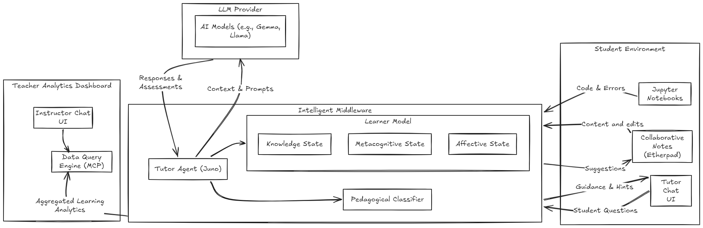

# JELAI: a Jupyter Environment for Learning Analytics and AI
## System Architecture

<a href="https://www.flaticon.com/free-icons/" title="icons" style="font-size: 0.5em;">Icons created by juicy_fish - Flaticon</a>

## Overview
JELAI is a system that integrates a Jupyter environment with a chatbot to provide a learning analytics and AI platform. 
The system is designed to support education using Jupyter notebooks, such as programming, data science and machine learning, by providing a collaborative environment where students can interact with Jupyter notebooks and receive assistance from a chatbot. 
The chatbot uses a large language model (LLM) to provide responses based on the chat history and the students' actions as they work through the notebooks. 

What makes JELAI unique is its ability to build a **holistic Learner Model** by triangulating data from multiple sources in real-time:
- **Code Telemetry**: The system tracks executed concepts (e.g., pandas imports, plotting functions) and execution errors to assess the student's *Knowledge* state.
- **Chat History**: The system classifies student questions (e.g., instrumental vs. executive help-seeking) to understand their thought process.
- **Etherpad Collaboration**: The system monitors word counts and collaborative text generation in Etherpad as a proxy for *Reflectivity*.

By combining these inputs, the Tutor Agent (Juno) dynamically updates the Learner Model to assess the student's **Metacognition** (e.g., detecting "Trial and Error" vs. "Reflective" states) and **Affect** (e.g., detecting frustration from consecutive errors). This allows the agent to deliver personalized, pedagogically sound hints that aim to foster deep understanding and instrumental help-seeking.

For instructors, the Teacher Chat (analytics chatbot) provides insights into student interactions, allowing them to monitor progress, identify areas where students need help, and provide targeted support.
For researchers, the system can be used to collect multi-modal tabular data on student interactions and explore the use of LLMs in educational settings.

Table of Contents:
- [Description](#description)
- [Setup and Configuration](#setup-and-configuration)
- [Development and Local Experimentation](#development-and-local-experimentation)
- [Teacher Chat (Instructor Analytics)](#teacher-chat-instructor-analytics)
- [Etherpad Integration](#etherpad-integration)

### Description
The system consists of a JupyterHub server, individual user Jupyter servers, a middleware server, Etherpad, and an LLM provider. 
- The JupyterHub server (containerized, running in the `jupyterhub-docker` Docker network) handles user authentication and management of individual user servers.
- The **individual user** Jupyter servers are automatically created (or *spawned*) when a user is created in the JupyterHub server (each user has their own container, which is connected to the `jupyterhub-docker` Docker network)
    - The user notebooks are based on the [Scipy-notebook](https://github.com/jupyter/docker-stacks/tree/main/images/scipy-notebook) image, including common packages for data science and machine learning.
    - The [Jupyterlab-pioneer](https://pypi.org/project/jupyterlab-pioneer/) Extension logs telemetry data from the user's interactions with the notebook.
    - The [Jupyter-chat](https://github.com/jupyterlab/jupyter-chat) Extension is used to integrate a chat interface into the notebook.
    - The `chat_interact.py` script in the notebook image is used to interact with the LLM-handler server by watching the chat files for changes and sending the messages to the server.
    - The `process_logs.py` script in the notebook image processes the telemetry logs from the JupyterLab-Pioneer extension to create a JSON file with the processed logs for each notebook.
- The **middleware** container runs the backend services:
    - The Tutor Agent (`ta-handler.py`) receives student messages, orchestrates calls to the Expert Agent and the LLM, manages student profiles, and maintains chat history using an SQLite database (`chat_histories` volume).
    - The Expert Agent (`ea-handler.py`) provides concise, factual technical information based on context provided by the TA.
    - Both agents are started via the `start.sh` script.
    - The LA module (in progress) processes telemetry logs to generate insights.
- **Fluent** is used to collect logs from the individual containers and send them to the middleware container for storage and processing with the LA module.
- The **LLM provider** can be a self-hosted Ollama server (on the host machine or on a separate one), an Open WebUI server, OpenAI, or any other OpenAI-compatible service, including services with a free tier (see [LLM providers](docs/llm-providers.md)).
- The **teacher dashboard and settings page** (port `8004`) show the learning story of each student and let teachers configure the tutor. They need the teacher password.
- **Etherpad** provides a collaborative text editor for students to work together in real-time, integrated into the JupyterLab environment. The `etherpad_logger.py` script logs pad changes for analytics.
- The **Teacher Chat** stack (optional, separate compose file) provides an instructor-facing analytics chat powered by LibreChat, LiteLLM, ClickHouse, and Langfuse (see [Teacher Chat](#teacher-chat-instructor-analytics) below).

## References
> Valle Torre, M., van der Velden, T., Specht, M., Oertel, C. (2025). JELAI: Integrating AI and Learning Analytics in Jupyter Notebooks. In Artificial Intelligence in Education: 26th International Conference, AIED 2025, Palermo, Italy, July 22–26, 2025, Proceedings, Part VI. Springer-Verlag, Berlin, Heidelberg, 68–75. https://doi.org/10.1007/978-3-031-98465-5_9

> Valle Torre, M., Specht, M., Oertel, C. (2026). LLM Chatbots in High School Programming: Exploring Behaviors and Interventions. In: Proceedings of the 41st ACM/SIGAPP Symposium on Applied Computing (SAC '26). Association for Computing Machinery, New York, NY, USA. https://arxiv.org/abs/2511.18985

> Valle Torre, M., Weijers, R., Specht, M., Oertel, C. (2026). Process Collapse or Compensatory Strategy? Profiling and Scaffolding Help-Seeking with an AI Tutor. Preprint. Available at SSRN: https://ssrn.com/abstract=6297817 or http://dx.doi.org/10.2139/ssrn.6297817


## Setup and Configuration
This setup was developed and tested on Ubuntu 22.04 and 24.04. It works on any Linux server with Docker.

### Prerequisites
- Docker with Docker Compose v2.24 or later
- An LLM: a self-hosted Ollama server, an Open WebUI server with an API key, an OpenAI key, or a free hosted provider (see [LLM providers](docs/llm-providers.md))

### Quick Start
1. Clone this repository.
2. Run the setup script. It asks for the LLM provider, the API key and a teacher password, and it writes `jupyterhub-docker/.env` and the Etherpad API key:
    ```bash
    ./setup.sh
    ```
3. Build and start the stack:
    ```bash
    cd jupyterhub-docker
    docker compose build
    docker compose up -d
    ```
4. Open JupyterHub at `http://<server>:8000`. Sign up with the admin user name that you gave to the setup script (default `admin`). Then approve the students at `http://<server>:8000/hub/authorize`, or set `JUPYTERHUB_OPEN_SIGNUP=true` in `.env`.
5. Open the teacher dashboard at `http://<server>:8004/teacher-view` (user name `teacher`, the password from the setup script). Click **Settings** to configure the tutor and to test the LLM connection.

To stop the system, run `docker compose down`. The data stays in Docker volumes.

Without the script, copy `jupyterhub-docker/.env.example` to `jupyterhub-docker/.env`, edit it, and make the Etherpad key with `openssl rand -hex 32 > jupyterhub-docker/etherpad/APIKEY.txt`.

### LLM Provider
All LLM requests go to one OpenAI-compatible API. Set the provider in `jupyterhub-docker/.env`:

| `LLM_PROVIDER` | Use it for | Necessary settings |
|---|---|---|
| `ollama` | A self-hosted Ollama server | `LLM_BASE_URL` if Ollama is not on the same machine |
| `openwebui` | An Open WebUI server | `LLM_BASE_URL` (server URL), `LLM_API_KEY` |
| `openai` | OpenAI | `LLM_API_KEY` |
| `groq`, `mistral`, `gemini`, `openrouter`, `ollama-cloud` | Hosted providers with a free tier | `LLM_API_KEY` |
| `custom` | Any other OpenAI-compatible server | `LLM_BASE_URL`, usually `LLM_API_KEY` |

Set `LLM_MODEL` for the model, or `LLM_MODEL_CLASSIFICATION`, `LLM_MODEL_RESPONSE`, etc. for a different model for each task. After a change, run `docker compose up -d middleware`.

**Schools without a GPU server or an API budget** can use a free tier. See [docs/llm-providers.md](docs/llm-providers.md) for the limits, the number of requests that a class uses, and privacy notes.

The earlier variables (`ollama_url`, `webui_url`, `webui_api_key`, `ollama_*_model`) in `jupyterhub-docker/middleware/.env` still work.

### Pedagogical Configuration
Teachers configure how the tutor **identifies** student activity, **classifies** student messages and selects **interventions**. The settings are in `jupyterhub-docker/middleware/inputs/`, and teachers can edit them on the settings page (`http://<server>:8004/teacher-settings`). Changes apply to the next message, without a restart.
- **`agent_config.yaml`**: the main file. It contains the tutor name, the concept patterns and learner model thresholds, the classification categories and prompt, the reactive intervention rules, the proactive intervention settings and prompt, the message filter, and the chat commands.
- **Tutor Agent System Prompt**: `ta_system_prompt.txt`.
- **Expert Agent System Prompt**: `ea_system_prompt.txt`.
- **Assignments**: `assignment_descriptions/`, `learning_objectives/` and `next_steps/`, with one `<notebook>.txt` file for each notebook.
- **A/B experiments**: `ab_experiments.json` (no experiment is active by default).

If a `.txt` file does not exist, the tutor uses the `.txt.sample` file. See [docs/teacher-configuration.md](docs/teacher-configuration.md) for all settings and examples.

### Individual User Servers
The individual user servers are automatically created (or *spawned*) when a user is created in the JupyterHub server. These servers include the necessary configuration for the JupyterLab-Pioneer and Jupyter-Chat extensions to log telemetry data and enable chat functionality in the notebook. The image is built automatically using the Dockerfile in the user-notebook directory.

### User/Student Working Environment

In the Dockerfile in the user-notebook directory, the working directory for the chatbot interaction is set to the **working-directory** environment variable. This is the local directory where students see their notebooks and chat files. 
To add course or experiment materials, the files can be added to the **working-directory** in the user-notebook image.

#### Learning Materials Directory
A special directory, `learning_materials`, is provided in `jupyterhub-docker/user-notebook/` for sharing datasets, notebooks, and other resources with all users. 
- Any files or folders placed in `learning_materials` will be copied into the Docker image and made available to all users at `/home/jovyan/learning_materials/` in their JupyterLab environment.
- This is useful for distributing course datasets, starter notebooks, or reference materials.
- By default, only `.gitkeep` and `README.md` are tracked by git in this directory; all other contents are ignored to prevent accidental commits of large or user-specific files. You can add or remove files as needed for your course or project.
- To update the materials for all users, add or update files in `learning_materials` and rebuild the user-notebook image.

Additionally, the default directory for chat files can be set via the `CHAT_DIR` environment variable, which is configured in `jupyterhub-docker/docker-compose.yml` under the `user-notebook` service.  
For example:
```yaml
user-notebook:
  ...
  environment:
    - CHAT_DIR=chats   # Change 'chats' to your desired directory name
```
The chat interaction app (`chat_interact.py`) will monitor `/home/jovyan/work/${CHAT_DIR}` for chat files.  
**To change the chat directory:** edit the `CHAT_DIR` value in the `environment` section and rebuild/restart the containers.

> **Note:**  
> The `args` section under `build` is only needed if you want to change the build-time setup. For most use cases, only the `environment` line matters.

### Chatbot File Watcher
The chat interaction app in **chat_interact.py** watches the chat files for changes and sends the messages to the chatbot server. It automatically runs in the individual containers.
The [Jupyter-chat](https://github.com/jupyterlab/jupyter-chat) extension used to limit exploration to the JupyterLab [root directory](https://github.com/jupyterlab/jupyter-chat/issues/61). 
Now the directory can be specified in the Dockerfile of the user-notebook image, for example by setting ``{"defaultDirectory": "chats/"}'`.

### Ollama Server
For a local LLM server, you can use [Ollama](https://ollama.com/). 
- To run Ollama in one machine and access it from a different one, follow the instructions in the [Ollama server documentation](https://github.com/varunvasudeva1/ollama-server-docs?tab=readme-ov-file) to install and run Ollama as a service.
- To run it locally for experimentation, just install it following the steps in [Ollama](https://ollama.com/). 
- Ollama can also run in a Docker container, so you don't have to install it. To run the Ollama server in a container, run the following command:
    - `docker run -d -p 11434:11434 ollama/ollama:latest`
Performance will depend on the host server's capability, we have achieved acceptable responses with basic conversations in English using Gemma3:4b and Llama3.2 (pretty small models) and great answers within 15 seconds with the Llama3.1:70b, Gemma2:27b and Gemma3:27b on an Nvidia A40 GPU. 

To use Ollama on the host machine, set `LLM_PROVIDER=ollama` and keep `LLM_BASE_URL` empty. The middleware connects to `http://host.docker.internal:11434/v1`. Make sure that Ollama listens on all interfaces (`OLLAMA_HOST=0.0.0.0`). For hosted providers, see [LLM providers](docs/llm-providers.md).

### Nginx Reverse Proxy
To access JupyterHub from outside the local network, follow the official [JupyterHub documentation](https://jupyterhub.readthedocs.io/en/stable/howto/configuration/config-proxy.html#nginx) to set up the Nginx reverse proxy. Similarly, to serve Ollama from a separate machine to the one running JELAI, you can use the Nginx reverse proxy to forward requests to Ollama, see the [Ollama server documentation](https://github.com/ollama/ollama/blob/main/docs/faq.md#how-can-i-use-ollama-with-a-proxy-server) for details.

## Teacher Chat (Instructor Analytics)

The Teacher Chat stack provides an instructor-facing analytics interface. It runs as a **separate Docker Compose stack** alongside the main JELAI system, using `docker-compose-teacher.yml`.

### Architecture

The stack consists of the following services:

| Service | Purpose | Port |
|---------|---------|------|
| **LibreChat** | Chat UI for instructors | `3080` |
| **LiteLLM** | LLM proxy/gateway (routes to Ollama/WebUI) | `4000` |
| **MCP Middleware** | Provides MCP tools for querying student data | `8005` |
| **ClickHouse** | Columnar database storing student interaction events | `8123` |
| **Langfuse** | LLM observability and tracing | `3001` |
| **MongoDB** | LibreChat data store | — |
| **PostgreSQL** | Langfuse data store | — |

Instructors interact with LibreChat, which uses LiteLLM as its LLM backend. LibreChat connects to the MCP Middleware via the Model Context Protocol (MCP), giving the LLM access to tools that query ClickHouse for student analytics data (event logs, semantic search over student code and chat messages).

### Setup

1. **Configure environment variables:**
    - Navigate to the `teacher-chat/` directory.
    - Copy the example file: `cp .env.teacher.example .env.teacher`
    - Edit `.env.teacher` and set:
      - `OLLAMA_API_KEY` — your LLM API key, if using WebUI or other OpenAI compatible API
      - `LANGFUSE_PUBLIC_KEY` / `LANGFUSE_SECRET_KEY` — from your Langfuse dashboard (or keep defaults for local-only use)
      - `LANGFUSE_INIT_USER_PASSWORD` — admin password for Langfuse
      - `DATASETS_HOST_PATH` — absolute path to your datasets directory on the host
    - The LibreChat credentials in `teacher-chat/.env` (JWT secrets) are pre-generated. Regenerate them for production.

2. **Build and start the stack:**
    ```bash
    docker compose -f docker-compose-teacher.yml --env-file teacher-chat/.env.teacher up -d
    ```

3. **Access the services:**
    - LibreChat (teacher analytics chat): `http://localhost:3080`
    - Langfuse (LLM tracing dashboard): `http://localhost:3001`
    - ClickHouse playground: `http://localhost:8123/play`

4. **Stop the stack:**
    ```bash
    docker compose -f docker-compose-teacher.yml down
    ```

### Configuration

- **LLM models**: Edit `teacher-chat/litellm/config.yaml` to add or change the available models and their API endpoint.
- **LibreChat behavior**: Edit `teacher-chat/librechat/librechat.yaml` to configure the chat interface, system prompt, and MCP server connection.
- **ClickHouse schema**: Initialization scripts are in `teacher-chat/clickhouse/init/`.
- **MCP tools**: The MCP middleware (`teacher-chat/mcp-middleware/server.py`) provides tools for dataset stats, student summaries, event search, and semantic search.

### Environment Files

| File | Purpose | Git-tracked? |
|------|---------|:---:|
| `teacher-chat/.env` | LibreChat JWT/CREDS secrets | ❌ (gitignored) |
| `teacher-chat/.env.teacher` | All teacher-chat stack secrets (API keys, DB passwords, Langfuse credentials) | ❌ (gitignored) |
| `teacher-chat/.env.teacher.example` | Safe template with placeholders | ✅ |

## Etherpad Integration

JELAI integrates [Etherpad](https://etherpad.org/) as a collaborative real-time text editor for students. Etherpad runs as a separate container in both the production (`docker-compose.yml`) and development (`docker-compose-dev.yml`) stacks.

- **Pads**: Each student writes in the pad with their JupyterHub user name: `http://<server>:9001/p/<username>`. The development stack uses one pad, `test_pad`.
- **API Key**: `setup.sh` writes a random key to `jupyterhub-docker/etherpad/APIKEY.txt`. Etherpad, the middleware and the notebooks read it from there. The file is not in git.
- **Logging**: The `etherpad_logger.py` script in the user notebook image monitors pad changes and writes logs for analytics.
- **Data**: The pads are kept in the `etherpad-data` Docker volume.
- **Configuration**: Authentication is disabled (`REQUIRE_AUTHENTICATION=false`), so a person who knows a pad name can open it. Use Etherpad only on a trusted network, or put it behind a reverse proxy with authentication.
- **Disable**: Set `ETHERPAD_ENABLED=false` and remove `etherpad` from `COMPOSE_PROFILES` in `jupyterhub-docker/.env`.

## FAQ:
- Where can I edit the system prompt for the assistant?
    - On the teacher settings page (`http://<server>:8004/teacher-settings`), or in **jupyterhub-docker/middleware/inputs/ta_system_prompt.txt**. See the *Pedagogical Configuration* section for other related files.
- How do I change the classification categories or the interventions?
    - Edit `agent_config.yaml` on the teacher settings page. See [docs/teacher-configuration.md](docs/teacher-configuration.md).
- Can I add notebooks or materials so they are available to all users?
    - Yes, you can add course materials to the **working-directory** in the user-notebook image, using the Dockerfile.
- What if I can't run Ollama locally?
    - Use an Open WebUI server, OpenAI, or a hosted provider with a free tier. See [docs/llm-providers.md](docs/llm-providers.md).
- The tutor answers "I'm sorry, I encountered an issue". What do I do?
    - Open the teacher settings page and click **Test connection**. Look at the logs with `docker compose logs middleware`.
- How do I set up the Teacher Chat stack?
    - See the [Teacher Chat (Instructor Analytics)](#teacher-chat-instructor-analytics) section. It runs as a separate Docker Compose stack using `docker-compose-teacher.yml`.
- Where do I put my API keys for the Teacher Chat?
    - All secrets go in `teacher-chat/.env.teacher`. Copy `teacher-chat/.env.teacher.example` as a starting point. This file is gitignored.

## Development and Local Experimentation
To run the system locally for development and experimentation, you can use **JupyterLab** (instead of JupyterHub) and the chatbot server in your local environment.
For this setup you only need Docker Desktop, it's been tested on iOS and Windows (via WSL). 

For the local Ollama server, see the steps above, if you have access to a webui or ollama server, you can add the info to the **.env**, see below.

- Clone this repository to your local machine
- Run the Ollama server (see above)
- Run `./setup.sh` to make `jupyterhub-docker/.env` and the Etherpad API key (the development stack uses the same file).
- Run `docker compose -f 'docker-compose-dev.yml' build` to create all the images
- Run `docker compose -f 'docker-compose-dev.yml' up -d` to start the images
- Run `docker compose -f 'docker-compose-dev.yml' down` to stop them
- JupyterLab is at `http://localhost:8888/?token=dev`. The teacher dashboard is at `http://localhost:8004/teacher-view` (user `teacher`, password `dev` unless `TEACHER_PASSWORD` is set).
- If you make changes to the Python code (e.g., in `ta-handler.py` or `ea-handler.py` in the **jupyterhub-docker/middleware** directory), you need to rebuild the middleware container:
    - Run `docker compose -f 'docker-compose-dev.yml' up -d --build middleware-dev`
- Changes to files in the **jupyterhub-docker/middleware/inputs** directory (like prompts or learning objectives) do **not** require a rebuild; they are reflected immediately because the directory is mounted as a volume.
- To run the middleware tests: `cd jupyterhub-docker/middleware && pip install pytest httpx fastapi pyyaml python-dotenv && python -m pytest tests`.
- Or just do `down` and `up` for the whole thing 

 
### For Step-by-step individual services:
This workflow does not require Docker, but it needs Python 3.11+ and `uv` (for package/project management).
1. Create a virtual environment and install dependencies for the Middleware (TA & EA):
    - Navigate to the Middleware directory: `cd jupyterhub-docker/middleware`
    - `python -m venv .venv` (or your preferred venv name)
    - `source .venv/bin/activate` (on Windows use `.venv\Scripts\activate`)
    - `uv pip install .` (This reads `pyproject.toml` and installs dependencies)
2. On a different terminal, create a venv and install dependencies for JupyterLab:
    - Navigate to the repository root: `cd ../..`
    - `python -m venv .venv-lab`
    - `source .venv-lab/bin/activate` (on Windows use `.venv-lab\Scripts\activate`)
    - `uv pip install jupyterlab notebook` *(Install other necessary lab extensions)*
3. On a third terminal, create a venv and install dependencies for the chat interaction script:
    - Navigate to the user-notebook directory: `cd jupyterhub-docker/user-notebook`
    - `python -m venv .venv-chat`
    - `source .venv-chat/bin/activate` (on Windows use `.venv-chat\Scripts\activate`)
    - `uv pip install -r chat_interact_requirements.txt`
4. Create your environment variables file for the Middleware:
    - Ensure you are in the **jupyterhub-docker/middleware** directory.
    - Create an **.env** file.
    - Add `LLM_PROVIDER=ollama` and `LLM_BASE_URL=http://localhost:11434/v1` (or the settings of your provider, see [docs/llm-providers.md](docs/llm-providers.md)).
5. Run the Middleware services (TA and EA):
    - **Terminal 1 (Middleware venv):** Run the Expert Agent:
        - `uvicorn ea-handler:app --host localhost --port 8003`
    - **Terminal 1a (Another Middleware venv, or run EA in background):** Run the Tutor Agent:
        - `uvicorn ta-handler:app --host localhost --port 8004`
    - *These servers must remain active.*
6. On the terminal running the **chat interaction** environment (from step 3), run the chat handler script:
    - `python chat_interact.py /path/to/your/notebooks/chats /path/to/your/processed/logs`
    - Replace the paths with the actual directories where your chat files will be saved by JupyterLab and where `process_logs.py` outputs its JSON files.
    - *This script must remain active.*
7. Add the jupyterlab-pioneer configuration file:
    - On the terminal with the **JupyterLab** environment, run `jupyter --path`
    - Copy the config file (see the [examples](https://github.com/educational-technology-collective/jupyterlab-pioneer/tree/main/configuration_examples)), named **jupyter_jupyterlab_pioneer_config.py** to the appropriate path. For development, use the **file_exporter** and set the correct path. See the config in **jupyterhub-docker/user-notebook/jupyter_jupyterlab_pioneer_config.py**.
    - You only have to do this once, the configuration will be saved in the JupyterLab configuration directory.
8. On the terminal with the **JupyterLab** environment (from step 2), run JupyterLab:
    - `jupyter lab --notebook-dir=/path/to/your/notebooks`
    - *Ensure the chat extension saves files to the directory monitored in step 6.*
9. To run the experimental log processing script, activate the **chat interaction** environment and run the script:
    - `python process_logs.py path-to-log-file path-to-output-directory`
    - This script will process the logs in the **logs** file (the one configured in step 7 **jupyter_jupyterlab_pioneer_config.py**) and create a JSON file with the processed logs for each notebook in the given directory.
    - For the LLM to see the logs as context, <ins>the notebook and the chat file must have the same name</ins>.